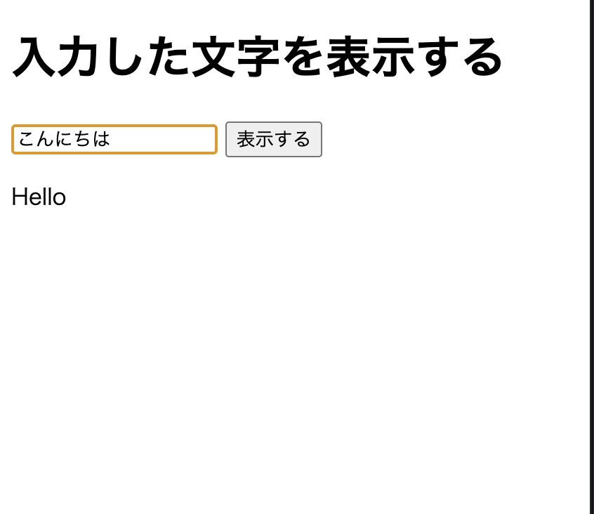
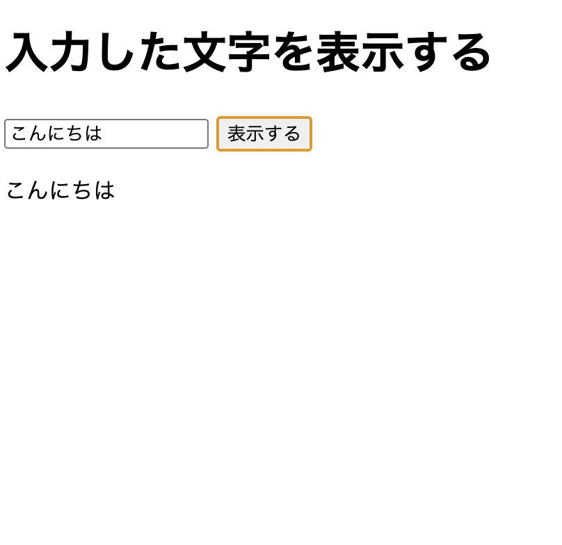

# 100knock

# 課題36

textContentは文字をそのまま表示するが、innerHTMLはHTMLとして読み込むため、悪意のあるスクリプトを実行されるXSS攻撃の危険性がある。

# htmlのコード

<!DOCTYPE html>
<html lang="ja">
<head>
    <meta charset="UTF-8">
    <title>入力とDOMの書き換え</title>
</head>
<body>

    <h1>入力した文字を表示する</h1>

    <input type="text" id="userInput" placeholder="文字を入力">

    <button id="changeBtn">表示する</button>

    
Hello

    
</body>
</html>

 # main.js
 <a href="03/main.js">main.js</a>

const input = document.getElementById("userInput");
const button = document.getElementById("changeBtn");
const msg = document.getElementById("msg");

button.addEventListener("click", function() {
    const value = input.value;
    msg.textContent = value;
});

